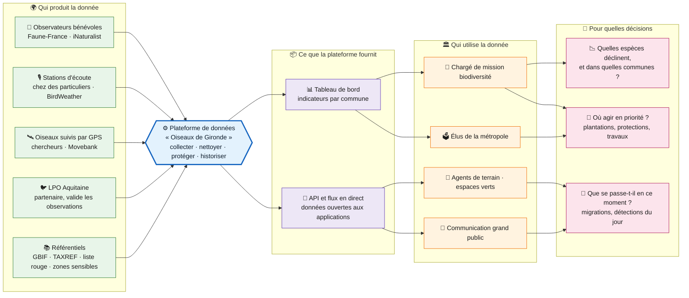
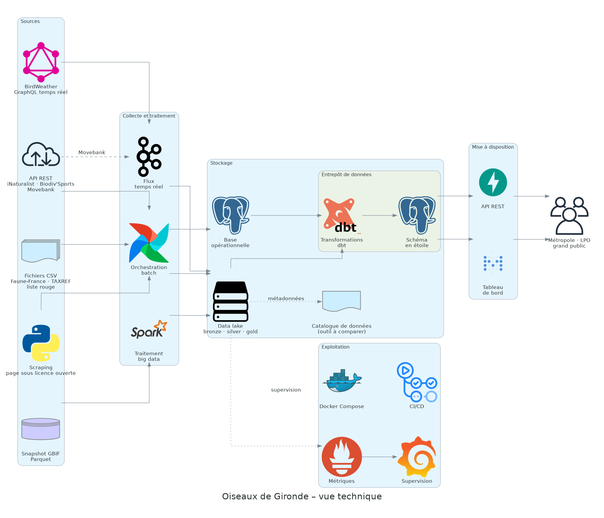

# Cadrage du projet « Oiseaux de Gironde »

> Version 0.1, du 06/11/2026. C'est un document de travail : il sert de boussole pour le code, puis de base à la note de synthèse et à l'avant-projet d'E2.
> Les points marqués 🔎 sont des hypothèses à valider, en général avec le formateur.

## 1. Le besoin

**Organisation cliente (fictive) :** Bordeaux Métropole, plus précisément son service Nature et biodiversité. Elle travaille avec la LPO Aquitaine.

**Le problème :** les données sur les oiseaux du territoire existent, mais elles sont éparpillées. On les trouve dans des sciences participatives (iNaturalist, Faune-France), des agrégateurs (GBIF), des capteurs acoustiques (BirdWeather) et des suivis GPS (Movebank). Aucune vue consolidée ne permet à la métropole de suivre l'évolution des espèces commune par commune, ni de décider où agir.

**La question de décision :**

> Dans quelles communes de Bordeaux Métropole les populations d'oiseaux évoluent-elles le plus, et où la métropole doit-elle agir en priorité ?

Deux usages en découlent :

| Usage | Rythme | Pour qui |
| --- | --- | --- |
| Suivre l'évolution des espèces par commune et par année, en croisant avec leur statut de menace (liste rouge) | Batch, mise à jour quotidienne ou hebdomadaire | Chargé de mission biodiversité, élus |
| Voir en direct l'activité détectée : stations acoustiques, oiseaux suivis par GPS, observations du jour | Temps réel | Agents de terrain, LPO, communication grand public |

## 2. Les parties prenantes

Ce tableau prépare les deux grilles d'entretien d'E1 : une pour ceux qui **produisent** la donnée, une pour ceux qui l'**exploitent**.

| Rôle | Qui | Grille E1 |
| --- | --- | --- |
| Commanditaire | Direction Nature et biodiversité de Bordeaux Métropole | Exploitants |
| Utilisateur principal | Chargé de mission biodiversité | Exploitants |
| Décideurs | Élus à l'environnement | Exploitants |
| Utilisateurs secondaires | Service espaces verts, urbanisme | Exploitants |
| Partenaire et producteur | LPO Aquitaine (gestion de Faune-France en Gironde) | Producteurs |
| Producteurs bénévoles | Observateurs Faune-France et iNaturalist, propriétaires de stations BirdWeather | Producteurs |
| Producteurs scientifiques | Chercheurs qui publient des suivis GPS sur Movebank | Producteurs |
| Équipe projet | Data engineer (moi), data analyst, DPO de la métropole | Les deux |

## 3. Les objectifs (SMART)

1. **Consolider** les observations d'oiseaux de la Gironde de 2015 à 2025, issues d'au moins 4 sources, dans un entrepôt de données unique, d'ici fin janvier 2027.
2. **Mettre à disposition** les indicateurs par commune (nombre d'espèces, tendance, espèces menacées) via une API REST documentée et un tableau de bord, d'ici fin février 2027.
3. **Intégrer en temps réel** les détections BirdWeather et les positions Movebank dans le data lake, avec moins de 5 minutes entre la détection et sa disponibilité, d'ici fin février 2027.

## 4. Le périmètre

**Dans le périmètre :**
- le territoire : la Gironde, avec un focus sur les 28 communes de Bordeaux Métropole ;
- la période : l'historique 2015-2025, plus le flux en continu ;
- tous les oiseaux (classe Aves), avec le statut liste rouge des espèces ;
- la collecte, le nettoyage, le stockage (base, entrepôt, data lake), l'API, la gouvernance et un tableau de bord simple.

**Hors périmètre :**
- l'identification d'espèces par l'image ou le son (pas de machine learning) ;
- une application mobile ou une saisie d'observations ;
- l'expertise naturaliste : le projet évalue un data engineer, pas un ornithologue.

## 5. Les sources, par type exigé par C8

| Type exigé (C8) | Source | Accès | Statut |
| --- | --- | --- | --- |
| Service web (API REST) | iNaturalist : observations d'oiseaux | API publique, environ 60 requêtes par minute | ✅ Testée |
| Service web (API REST) | Biodiv'Sports : zones sensibles pour la faune | API Geotrek v2 publique | ✅ Testée |
| Service web (API) | Movebank : suivi GPS (par exemple, les cigognes) | API JSON publique, licence propre à chaque étude | ✅ Testée |
| Service web (GraphQL + temps réel) | BirdWeather : détections acoustiques | API GraphQL et abonnement `newDetection` | ⏳ Licence à confirmer |
| Scraping | Une page sous licence ouverte (par exemple Wikipédia), pour enrichir les espèces | Scraping HTML | 🔎 Page à choisir |
| Fichier | Extraction Faune-France (CSV), sinon téléchargement GBIF ; référentiels TAXREF et liste rouge | Fichiers | ⏳ Selon la réponse de la LPO |
| Base de données | Base PostgreSQL opérationnelle du projet | SQL | ✅ |
| Système big data | Snapshot GBIF en Parquet, traité avec Spark | Parquet + Spark | 🔎 À valider avec le formateur |

**Règle de sécurité :** le projet doit tourner entièrement **sans** les données de la LPO. Si elles arrivent, elles enrichissent le projet ; si elles n'arrivent pas, GBIF et iNaturalist suffisent.

## 6. L'architecture cible

### 6.1 Vue métier

Pour un public non technique (élus, LPO, jury d'E1 à E3) : qui produit la donnée, ce que fait la plateforme et à quelles décisions elle sert.

### 6.2 Vue technique

Pour les épreuves techniques (E4, E5, E7) : les briques et les flux de données, avec les logos des outils.

Ce schéma est généré par du code avec la librairie `diagrams` : [generer_vue_technique.py](architecture/generer_vue_technique.py). Pour le mettre à jour, on modifie le script puis on le relance. Les instructions sont en tête du script.

**Choix techniques pressentis :**

| Brique | Choix pressenti | Pourquoi | Statut |
| --- | --- | --- | --- |
| Langage | Python 3.14 | Supporté par dbt, PySpark et Airflow | ✅ Décidé |
| Orchestration | Airflow | Standard du métier, planifie les collectes | 🔎 À confirmer |
| Base opérationnelle et entrepôt | PostgreSQL + dbt | Demandé dans la formation, gère les SCD | ✅ Décidé |
| Données géographiques | PostGIS + référentiel des communes (geo.api.gouv.fr) | Rattacher chaque observation à sa commune en SQL ([fiche 0001](decisions/0001-postgis.md)) | ✅ Décidé |
| Big data | Spark sur le snapshot GBIF | Volume réel : plusieurs milliards d'occurrences au total | 🔎 À valider |
| Data lake | Stockage objet compatible S3 (par exemple MinIO), en Parquet | Tourne en local avec Docker | 🔎 À confirmer |
| Temps réel | Consommateur Python ; file de messages (Kafka ou Redpanda) si besoin | Abonnement BirdWeather et sondage de Movebank | 🔎 À concevoir |
| Catalogue | À choisir après comparaison (E7 l'exige) | OpenMetadata, DataHub, etc. | 🔎 Comparaison à faire |
| API | FastAPI | Documentation OpenAPI générée automatiquement (C12) | ✅ Décidé |
| Infrastructure | Docker Compose sous WSL, CI GitHub Actions | Installation reproductible, testée en CI (E7) | ✅ En place |

## 7. Les contraintes

- **Délai :** soutenance à partir de mi-avril 2027.
- **Budget :** 0 €. Uniquement des outils open source, qui tournent en local.
- **RGPD :**
  - aucun nom d'observateur n'est stocké ;
  - les coordonnées des stations BirdWeather (souvent chez des particuliers) sont arrondies ;
  - les localisations des espèces sensibles sont floutées, en s'appuyant sur les zones Biodiv'Sports ;
  - un registre des traitements est tenu (C11).
- **Licences :** seules les données sous licence compatible sont conservées. Pour iNaturalist, ce sont CC0, CC BY, CC BY-SA, CC BY-NC et CC BY-NC-SA, soit 56 % des observations. Chaque source est citée.
- **Limites d'appel :** on respecte les limites de chaque API, avec un cache et des reprises sur erreur.

## 8. Les risques

| Risque | Probabilité | Impact | Parade |
| --- | --- | --- | --- |
| La LPO ne répond pas ou refuse | Moyenne | Faible | GBIF et iNaturalist couvrent le besoin |
| BirdWeather refuse la réutilisation | Faible | Moyen | Temps réel avec Movebank et iNaturalist, ou flux simulé |
| GBIF + Spark refusé comme « big data » | Faible | Fort | Demander au formateur quelle source il accepte, dès maintenant |
| E6 et E7 refusés sur ce projet | Moyenne | Moyen | Faire E6 et E7 sur les briefs du formateur |
| Machine trop juste pour Spark + Airflow + Kafka en local | Moyenne | Moyen | Travailler sur un échantillon GBIF ; passer certaines briques dans le cloud |
| Dispersion sur l'aspect naturaliste | Moyenne | Moyen | Tout ramener à la question de décision |

## 9. Correspondance avec les épreuves

| Épreuve | Ce que le projet fournit |
| --- | --- |
| E1 | Les deux grilles d'entretien construites à partir des parties prenantes (section 2) |
| E2 | Ce cadrage, enrichi : note de synthèse, avant-projet, planning, suivi, bilan |
| E3 | La présentation de lancement : feuille de route, calendrier, stratégie de communication |
| E4 | Les scripts de collecte des 5 types de sources, le nettoyage, la base PostgreSQL et l'API FastAPI |
| E5 | L'entrepôt PostgreSQL + dbt en étoile : un fait « observation » et des dimensions espèce, date, commune et source |
| E6 | 🔎 Si validé : une évolution de l'entrepôt (nouvelle source Movebank, statut liste rouge en SCD de type 2) |
| E7 | 🔎 Si validé : le data lake (batch + temps réel), son catalogue, sa supervision et sa gouvernance |

## 10. Prochaines étapes

1. Premier script d'ingestion : iNaturalist vers PostgreSQL, avec ses tests.
2. Mise en place de Docker Compose : PostgreSQL d'abord, puis les autres briques au fur et à mesure.
3. Modèle de données de l'entrepôt (schéma en étoile).
4. Ajout des autres sources, une par une.
